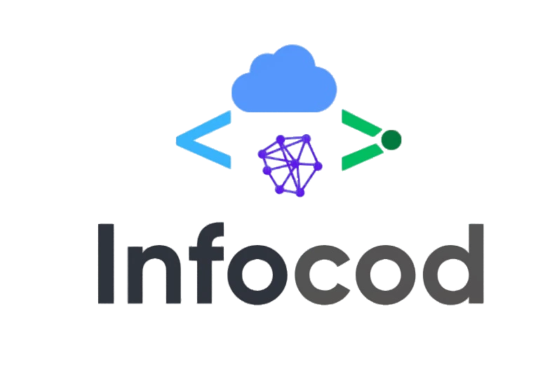

<div align="center">

  

  # **Infocod — Plataforma Digital & Arquitectura de Software**
  
  **Sistemas de Información a Medida • Business Intelligence • Inteligencia Artificial**

  [](https://nextjs.org/)
  [](https://react.dev/)
  [](https://www.typescriptlang.org/)
  [](https://tailwindcss.com/)
  [](https://supabase.com/)
  [](#licencia)

  <p align="center">
    <em>"Tu negocio genera datos todos los días. Nosotros los convertimos en decisiones. Sistemas web invencibles y software de alto rendimiento."</em>
  </p>

  [Sitio Web](https://infocod.codes) • [Explorar Productos](#-ecosistema-de-productos) • [Instalación](#-instalación-y-puesta-en-marcha) • [Arquitectura](#-arquitectura-y-estructura-del-código) • [Contacto](#-contacto--soporte)

</div>

---

## 📌 Tabla de Contenidos

- [Acerca del Proyecto](#-acerca-del-proyecto)
- [Características Principales](#-características-principales)
- [Ecosistema de Productos](#-ecosistema-de-productos)
- [Servicios Especializados](#-servicios-especializados)
- [Stack Tecnológico](#-stack-tecnológico)
- [Arquitectura y Estructura del Código](#-arquitectura-y-estructura-del-código)
- [Instalación y Puesta en Marcha](#-instalación-y-puesta-en-marcha)
  - [Opción A: Clonar con Git](#opción-a-clonar-mediante-git)
  - [Opción B: Descargar Archivo ZIP](#opción-b-descargar-como-archivo-zip)
  - [Variables de Entorno](#-configuración-de-variables-de-entorno)
- [Scripts y Comandos Disponibles](#-scripts-disponibles)
- [Seguridad y Buenas Prácticas](#-seguridad-y-blindaje)
- [Licencia](#-licencia)

---

## 🚀 Acerca del Proyecto

**Infocod Web** es la plataforma web oficial de **Infocod**, una firma de ingeniería y consultoría tecnológica enfocada en el desarrollo de software a medida, automatización empresarial y ciencia de datos.

El proyecto está diseñado bajo los estándares más exigentes de la industria moderna:
- **Cero Deuda Técnica:** Código estructurado en TypeScript estricto con tipado completo de extremo a extremo.
- **Rendimiento Extremo:** Optimización de carga (< 50ms de First Contentful Paint) utilizando Server-Side Rendering (SSR) y Static Site Generation (SSG) de Next.js 16.
- **Identidad Visual de Vanguardia:** Paleta cromática corporativa (Azul Eléctrico `#4F8EF7`, Verde Esmeralda `#00C96B` y Morado Profundo `#6C2BFF`), micro-animaciones fluidas con GSAP y shaders interactivos sobre lienzo HTML5 Canvas.

---

## ✨ Características Principales

* 🌐 **Hero Interactivo CyberGrid:** Fondo procedural de malla tridimensional generado dinámicamente con Canvas 2D, que responde en tiempo real a las coordenadas del cursor del usuario mediante física magnética.
* 🌀 **Animaciones Cinematográficas (GSAP + ScrollTrigger):** Transiciones con difuminado (*blur*), zoom adaptativo, desplazamiento de capas en cascada y texto tipo *Scramble* que decodifica caracteres dinámicamente.
* 🛡️ **Blindaje de Código Frontend:** Módulo `SecurityRules` integrado para prevención avanzada de inspección superficial, deshabilitación de selección arbitraria de textos y control de descarga no autorizada de assets.
* 📬 **Sistema de Contacto y Cotización Transaccional:** Integración con backend de correos automáticos usando **Resend** y `@react-email/components`, validación estricta con **Zod** y **React Hook Form**.
* ⚡ **Limitador de Tasa (Rate Limiting):** Protección anti-abuso y prevención de spam mediante **Upstash Redis** (`@upstash/ratelimit`).
* 🔒 **Autenticación y Persistencia con Supabase:** Integración SSR mediante `@supabase/ssr` con políticas de seguridad de nivel de fila (Row-Level Security / RLS).

---

## 📦 Ecosistema de Productos

Infocod desarrolla soluciones propietarias listas para producción:

| Producto | Categoría | Estado | Descripción |
| :--- | :--- | :---: | :--- |
| **Agenda+** | *Productividad & Proyectos* | `App Oficial` | Dashboard integral para gestión de tareas, control de proyectos y seguimiento de hábitos sin distracciones con analíticas de productividad en tiempo real. |
| **Masticod** | *POS & ERP Modular* | `En Desarrollo` | Ecosistema de software de Punto de Venta especializado por industrias (abarrotes, farmacias, ferreterías, retail) sin módulos innecesarios. |
| **DataPilot** | *BI & Inteligencia Artificial* | `En Desarrollo` | Plataforma empresarial de Business Intelligence que conecta bases de datos crudas y las transforma en modelos predictivos y tableros interactivos para decisiones directivas. |

---

## 🛠️ Servicios Especializados

El catálogo de servicios de Infocod cubre 9 áreas fundamentales de tecnología:

1. **Sitios Web de Alto Impacto:** Páginas corporativas y landings de alta conversión optimizadas para SEO técnico.
2. **Sistemas Web a Medida:** Paneles administrativos, intranets y plataformas ERP/CRM de uso intensivo.
3. **Apps Móviles:** Aplicaciones nativas y multiplataforma con rendimiento nativo a 60/120 FPS (iOS y Android).
4. **Business Intelligence (BI):** Pipelines ETL automatizados, modelado de datos y paneles ejecutivos.
5. **Inteligencia Artificial (IA):** Implementación de modelos LLM, RAG (Retrieval-Augmented Generation) y visión computacional.
6. **Automatización (RPA):** Bots y flujos autónomos para eliminar tareas operativas manuales y repetitivas.
7. **Cloud & DevOps:** Despliegue de infraestructura elástica en la nube, pipelines CI/CD y monitoreo continuo.
8. **Consultoría IT & Auditoría:** Diagnóstico de arquitecturas existentes, refactorización y resolución de cuellos de botella.
9. **Plataformas SaaS:** Arquitectura multitenant escalable con pasarelas de pago recurrentes y microservicios.

---

## 💻 Stack Tecnológico

### Frontend & Core
* **Framework:** [Next.js 16.2.12](https://nextjs.org/) (App Router, Server Components y Server Actions)
* **Biblioteca UI:** [React 19.2.4](https://react.dev/) + React DOM 19
* **Lenguaje:** [TypeScript 5](https://www.typescriptlang.org/)
* **Estilizado:** [Tailwind CSS v4](https://tailwindcss.com/) + CSS Modules (`.module.css`)
* **Tipografía:** Google Fonts optimizadas vía `next/font` (Sora, Manrope, JetBrains Mono, Outfit, Bebas Neue, Fraunces)
* **Iconografía:** [Lucide React](https://lucide.dev/)

### Animaciones & Gráficos
* **Motor de Animación:** [GSAP 3.15](https://greensock.com/gsap/) (GreenSock Animation Platform) + `ScrollTrigger`
* **Entorno 3D:** [Three.js](https://threejs.org/) (`three` & `@types/three`)
* **Visualización de Datos:** [Recharts](https://recharts.org/) & [Leaflet / React Leaflet](https://react-leaflet.js.org/)

### Backend, Estado & Servicios
* **Base de Datos & Auth:** [Supabase](https://supabase.com/) (`@supabase/supabase-js`, `@supabase/ssr`)
* **Correos Transaccionales:** [Resend](https://resend.com/) + `@react-email/components`
* **Rate Limiting & Caché:** [Upstash Redis](https://upstash.com/) (`@upstash/ratelimit`, `@upstash/redis`)
* **Gestión de Estado:** [Zustand 5](https://github.com/pmndrs/zustand)
* **Formularios & Validación:** [React Hook Form](https://react-hook-form.com/) + [Zod](https://zod.dev/)

### Calidad de Código & Testing
* **Pruebas Unitarias:** [Vitest](https://vitest.dev/) + `jsdom`
* **Pruebas End-to-End:** [Playwright](https://playwright.dev/)
* **Linting & Git Hooks:** ESLint 9, Husky 9, Commitlint (Conventional Commits)

---

## 📂 Arquitectura y Estructura del Código

```text
infocod-web/
├── docs/                        # Documentación interna y reportes de desarrollo
├── e2e/                         # Pruebas automatizadas de extremo a extremo (Playwright)
├── public/                      # Assets estáticos, videos demostrativos e imágenes
│   ├── images/                  # Mascota Chuy, diagramas de procesos e ilustraciones
│   ├── productos/               # Assets de Agenda+, Masticod y DataPilot
│   └── videos/                  # Demostraciones en video de los productos
├── src/
│   ├── app/                     # Next.js App Router (Rutas, páginas y layouts)
│   │   ├── actions/             # Server Actions (envío de correos, cotizaciones)
│   │   ├── contacto/            # Página de cotización y contacto
│   │   ├── nosotros/            # Historia, misión y visión corporativa
│   │   ├── productos/           # Catálogo detallado de productos
│   │   ├── servicios/           # Detalle de áreas de ingeniería
│   │   ├── globals.css          # Variables CSS y tokens de diseño
│   │   ├── layout.tsx           # Layout global con fuentes y reglas de seguridad
│   │   └── page.tsx             # Página de inicio principal (Landing Page)
│   ├── components/              # Componentes de interfaz reutilizables
│   │   ├── CyberGrid/           # Malla cibernética interactiva con Canvas
│   │   ├── Footer/              # Pie de página corporativo
│   │   ├── LiquidTrail/         # Efecto de rastro fluido
│   │   ├── MagneticAura/        # Efecto de atracción magnética de cursor
│   │   ├── Navbar/              # Barra de navegación con indicador de scroll
│   │   ├── PrinciplesFanScroll/ # Sección de principios en abanico interactivo
│   │   ├── ProductsZigZag/      # Slider dinámico de productos en zig-zag
│   │   ├── ScrambleText/        # Animación de decodificación tipográfica
│   │   ├── SecurityRules.tsx    # Blindaje y control de eventos del cliente
│   │   ├── ServicesAccordion/   # Acordeón horizontal de servicios
│   │   ├── TechMarqueeSection.tsx # Carrusel de tecnologías soportadas
│   │   ├── contacto/            # Formularios y selects personalizados
│   │   └── emails/              # Plantillas de correo con React Email
│   ├── store/                   # Stores globales (Zustand)
│   └── utils/
│       └── supabase/            # Clientes de Supabase para Cliente, Servidor y Middleware
├── .gitignore                   # Exclusión de archivos sensibles y temporales
├── commitlint.config.js         # Configuración de mensajes de commit convencionales
├── next.config.ts               # Configuración avanzada de Next.js
├── package.json                 # Dependencias y scripts del proyecto
├── playwright.config.ts         # Configuración del entorno de pruebas E2E
├── tsconfig.json                # Configuración de compilación de TypeScript
└── vitest.config.ts             # Configuración del test runner unitario
```

---

## 📥 Instalación y Puesta en Marcha

### Prerrequisitos
Asegúrate de tener instaladas las siguientes herramientas en tu entorno local:
* **Node.js:** Versión `20.x` o superior recomendada ([Descargar Node.js](https://nodejs.org/)).
* **npm:** Versión `10.x` o gestor alternativo compatible (`pnpm`, `yarn`, `bun`).
* **Git:** Para clonar el repositorio ([Descargar Git](https://git-scm.com/)).

---

### Opción A: Clonar mediante Git

1. Abre tu terminal y clona el repositorio:
   ```bash
   git clone https://github.com/AlexaDoca58/Infocodweb.git
   ```

2. Entra al directorio del proyecto:
   ```bash
   cd Infocodweb
   ```

3. Instala las dependencias necesarias:
   ```bash
   npm install
   ```

---

### Opción B: Descargar como Archivo ZIP

1. En la parte superior de la página del repositorio en GitHub, haz clic en el botón verde **`Code`** y selecciona **`Download ZIP`**.
2. Descomprime el archivo `.zip` en tu carpeta de preferencia.
3. Abre una terminal dentro de la carpeta descomprimida y ejecuta:
   ```bash
   npm install
   ```

---

### 🔑 Configuración de Variables de Entorno

Crea un archivo llamado `.env.local` en la raíz del proyecto basándote en el siguiente esquema:

```env
# ========================================================
# SUPABASE (Base de datos y Autenticación)
# ========================================================
NEXT_PUBLIC_SUPABASE_URL=https://tu-proyecto.supabase.co
NEXT_PUBLIC_SUPABASE_ANON_KEY=tu_supabase_anon_key

# ========================================================
# RESEND (Servicio de Envío de Correos Transaccionales)
# ========================================================
RESEND_API_KEY=re_123456789abcdef
CONTACT_EMAIL_TO=contacto@infocod.codes

# ========================================================
# UPSTASH REDIS (Rate Limiting y Prevención de Abuso)
# ========================================================
UPSTASH_REDIS_REST_URL=https://tu-redis.upstash.io
UPSTASH_REDIS_REST_TOKEN=tu_upstash_token
```

---

## ⚡ Scripts Disponibles

En el directorio del proyecto puedes ejecutar los siguientes comandos:

| Comando | Descripción |
| :--- | :--- |
| `npm run dev` | Inicia el servidor de desarrollo en `http://localhost:3000` con recarga rápida (*Fast Refresh*). |
| `npm run build` | Compila y optimiza la aplicación para producción generando los bundles estáticos. |
| `npm run start` | Inicia el servidor de producción tras haber ejecutado `npm run build`. |
| `npm run lint` | Ejecuta ESLint para analizar el código en busca de errores sintácticos o de estilo. |
| `npm test` | Ejecuta las pruebas unitarias con Vitest. |
| `npm run test:e2e` | Ejecuta las pruebas completas de integración de extremo a extremo con Playwright. |

---

## 🛡️ Seguridad y Blindaje

El proyecto implementa múltiples capas de protección técnica:
* **Protección de Assets e Inspección:** Módulo reactivo [`SecurityRules.tsx`](src/components/SecurityRules.tsx) que previene accesos indebidos a inspección de código y descargas directas de assets propietarios.
* **Row-Level Security (RLS):** Toda consulta a la base de datos PostgreSQL en Supabase respeta políticas granulares de aislamiento de datos.
* **Rate Limiting por IP:** Los formularios públicos cuentan con límites de peticiones por minuto controlados por Redis para evitar inundaciones o spam masivo.
* **Control de Commits con Husky:** Validación automática de mensajes de commit mediante `commitlint` siguiendo la convención de *Conventional Commits* (`feat:`, `fix:`, `docs:`, `chore:`).

---

## 👥 Equipo y Créditos

* **Desarrollo & Arquitectura:** Equipo de Ingeniería de **Infocod**
* **Mascota Oficial:** Chuy el Zorro 🦊

---

## 📄 Licencia

Este proyecto y todo su código fuente, diseño, marcas comerciales y assets visuales son propiedad exclusiva de **Infocod**. Todos los derechos reservados. No está permitida la redistribución, copia o uso comercial no autorizado de los componentes sin previo consentimiento por escrito.

---

<div align="center">
  <sub>Construido con precisión de ingeniería por <strong>Infocod</strong> • 2026</sub>
</div>
